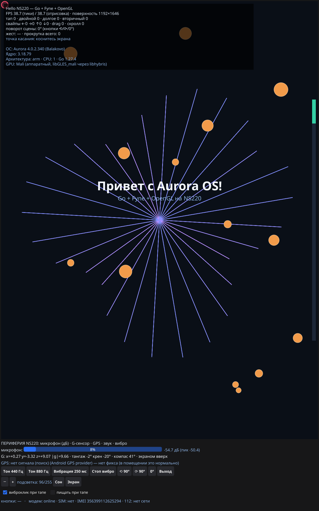

# aurora-hello-ns220 — «Hello world» на Go + Fyne + OpenGL для NS220

Демонстрационное приложение, доказывающее, что на планшете **MVK-2020 (NS220)** под
**Aurora 4.0.2.340** можно полноценно разрабатывать GUI на Go: окно Fyne рисуется
через OpenGL (Mali-T720 через libhybris), работает ввод, приложение ставится
RPM-пакетом и запускается из меню Aurora.



Первые снимки с устройства (для истории) — [`doc/history/`](doc/history/README.md):
`01-first-fullscreen-1200x1920.png` (10:23, после `-selftest`) и
`02-first-clean-render-1200x1920.png` (10:34, «чистый» кадр).

## Что показывает

| | |
|---|---|
| Приветствие | «Привет с Aurora OS!» + подпись Go+Fyne+OpenGL |
| Отрисовка | анимация «радар» (лучи) + упруго летающие круги; FPS в HUD: **тики анимации** и **фактические отрисовки** |
| Точка касания | красное перекрестие + кольцо в последней точке, затухающий след |
| Жесты | тап, двойной тап, долгое нажатие (≥650 мс), свайпы вправо/влево/вверх/вниз (≥60 px, ≤900 мс), перетаскивание, прокрутка; «волны» от тапов |
| Счётчики | по каждому жесту, последний жест, координаты касания |
| Окружение | ОС и версия, ядро, архитектура/CPU/Go, реальный GPU (Mali или llvmpipe), режим IMA (`ima_appraise`, `module.sig_enforce`), версии Fyne/GLFW |
| Звук | кнопки «Тон 440 Гц»/«Тон 880 Гц» (libpulse-simple через cgo), опция «пищать при тапе» |
| Микрофон | непрерывный уровень в дБ (RMS→dBFS, сглаживание, пик 1 с) + полоса |
| Вибро | «Вибрация 250 мс»/«Стоп», виброклик на тап (60 мс) и двойной (90 мс), sysfs timed_output; в журнале `VIBRO …` |
| Выход | кнопка «Выход» в панели; корректный SIGTERM/SIGINT; один экземпляр (повторный запуск поднимает окно существующего) |
| Кнопки | evdev event0/1/2 — последняя нажатая кнопка (VOLUMEUP/POWER/…), счётчик |
| Подсветка | «−/+» через setuid `aurora-brightness`, значение 0..255 в панели |
| Сон | «Сон/Экран» через mce; `-keepawake` не даёт экрану гаснуть (иначе сенсоры спят) |
| Модем/SIM | ofono: online, IMEI, SIM present; 112 без SIM недоступен |
| Поворот | кнопки «⟲ 90° / ⟳ 90° / 0°» поворачивают сцену (системный поворот в Aurora 4 залочен вендором, bugs B047); флаг `-rot N`; касания пересчитываются |
| Прокрутка | полоса прокрутки справа, «прокрутка всего» в HUD и всплывающее «⇅ …» у точки касания (двухпальцевый жест → GLFW scroll) |
| GPS | geoclue-hybris напрямую: статус, широта/долгота/высота, провайдер; юнит поднимается сам |
| G-сенсор | helper `sensor-reader` (QtSensors → sensorfw): ускорение x/y/z, \|g\|, тангаж/крен, компас (азимут), положение (портрет/ландшафт/экраном вверх) |

Замеры на устройстве (1200×1920, полный экран, ~70 объектов):
**Mali ≈ 40–46 fps**, **llvmpipe ≈ 16–18 fps** (≈2.6×).

## Сборка (на планшете)

```bash
cd /home/user/hello-ns220
./build.sh                 # Go 1.27.4 + патченный GLFW 3.4 + Fyne 2.8.2
./run.sh                   # Mali с автооткатом на llvmpipe
```

`build.sh` использует стенд `/home/opt` (`go127`, `aurora-fyne/go-glfw34`,
`usr/include`, `libs`, `pc`). Кэш модулей принадлежит root — сборка идёт через
`devel-su` (см. `scripts/deploy.sh` на хосте).

Флаги: `-fps` (тики/с), `-spokes`, `-bounces`, `-fullscreen=false`, `-w`, `-h`,
`-stats` (интервал журнала, 0 — выкл.), `-shot PATH -shot-delay D` (снимок окна
в PNG и выход), `-selftest` (прогон жестов, в конце — тон 660 Гц и вибро 250 мс),
`-mic=true|false`, `-accel=true|false`, `-gps=true|false`, `-vibro=true|false`,
`-beep=true|false` (пищать при тапе).

Периферия: `audio.go` (libpulse-simple), `vibrate.go`, `accel.go` (helper QtSensors),
`gps.go` (geoclue), `panel.go` (панель), `single.go` (один экземпляр).
API и замеры — `doc/15-PERIPHERALS.md`. Для сборки нужны симлинки `libpulse*.so`
в `/home/opt/libs` (doc/15 §15.2); helper сенсоров собирается
`helper/sensor-reader.cpp` (нужен `qt5-qtsensors-devel`) и ставится в
`/usr/libexec/aurora-hello-ns220/sensor-reader`.

Если G-сенсор показывает нули: vendor HAL «залипает» после нескольких клиентов
(bugs B045) — помогает `aurora-sensor-reset` (setuid) или перезагрузка; приложение
само пробует сброс после трёх неудач.

## Проверка без тачскрина

```bash
./run.sh -selftest -shot /home/user/shot.png -shot-delay 8s -stats 3s
# в логе: SELFTEST done: taps=3 double=1 hold=2 left=1 right=1 up=1 down=1 drag=1 scroll=1
```

`-selftest` вызывает те же обработчики Fyne, что и реальные события: проверяет
классификатор, счётчики, след и «волны» (на HUD это видно на снимке).

## RPM-пакет

```bash
cd packaging
SIGN=1 sh build-rpm.sh     # rpmbuild + подпись своим GPG-ключом
# -> aurora-hello-ns220-arm7-signed.rpm (armv7hl)
```

Пакет: `/usr/bin/aurora-hello-ns220` (+ лаунчер `-launch` с журналом в
`$HOME/hello-ns220.log`), `.desktop`, иконка в `/usr/share/icons/hicolor/256x256/apps`
и в теме Aurora (`/usr/share/themes/aurora-default/meegotouch/z1.0/icons`).
В `.desktop` стоит `[X-Sailjail] Sandboxing=Disabled` — иначе липстик запускает
приложение в песочнице (вопрос о разрешениях, падение; bugs B029), см.
`doc/06-PACKAGING.md` §6.6. Установка на устройстве (наша подпись валидатором
OMP не принимается — IMA должен быть выключен, см. `scripts/boot-mode dev`):

```bash
sudo rpm -ivh --define '__transaction_validation %{nil}' aurora-hello-ns220-arm7-signed.rpm
```

Подпись проверяется после импорта своего ключа:
`rpm --import pub.asc && rpm -Kv …` → `Header V3 RSA/SHA1 Signature, key ID … OK`.
Доверие OMP (запуск при `ima_appraise=enforce`) — отдельная задача, план 0009.

## Структура

```
hello-ns220/
├── main.go        точка входа, флаги, окно, -shot/-selftest
├── board.go       сцена (лучи/круги), HUD, анимация, FPS
├── input.go       обработка тапа/свайпов/drag/скролла, классификатор жестов
├── selftest.go    прогон жестов без тачскрина
├── devinfo.go     ОС/ядро/архитектура/GPU/IMA/версии
├── screen.go      размер экрана через GLFW (SetFullScreen на wl_shell не работает)
├── shot.go        снимок окна в PNG
├── build.sh       сборка на устройстве
├── run.sh         запуск (Mali/llvmpipe, локаль/Compose, Wayland)
├── scripts/deploy.sh   (хост) доставка исходников + сборка + запуск + снимок
├── packaging/     spec, .desktop, иконка, лаунчер, build-rpm.sh
├── preview.png    снимок с устройства (2026.11.21)
└── doc/history/   первые снимки «Hello world» + хронология первого запуска
```

## Грабли (подробно — `doc/ai/bugs/README.md`)

* B023 — не звать `fyne.Do` из анимационной горутины (очередь залипает);
  анимация — через `fyne.NewAnimation`.
* B024 — `SetFullScreen` на wl_shell → чёрный кадр; ресайз до размера экрана.
* B025 — без `LANG`/`XCOMPOSEFILE` окно не создаётся (XKB compose).
* B026/B027 — подпись RPM требует пакет `rpm-sign`; brp-strip-static-archive
  глушится (`busybox xargs`).
* B028 — GPU определять после старта GL.
* B029 — из меню приложение падало в песочнице sailjail (`Sandboxing=Disabled`).
* B030 — иконка: lipstick берёт её из темы Aurora, не из hicolor.
